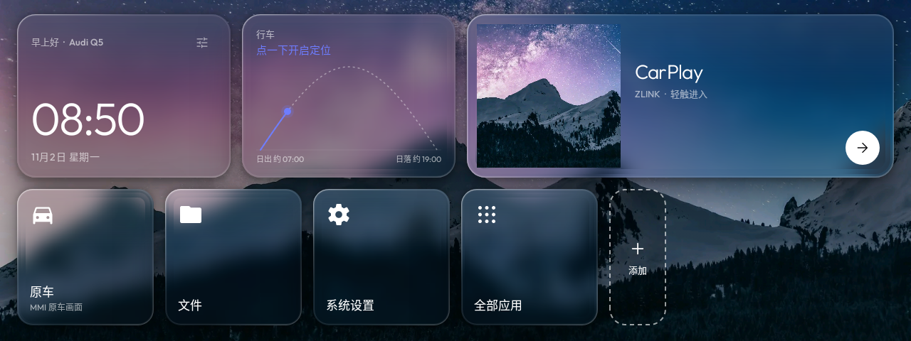
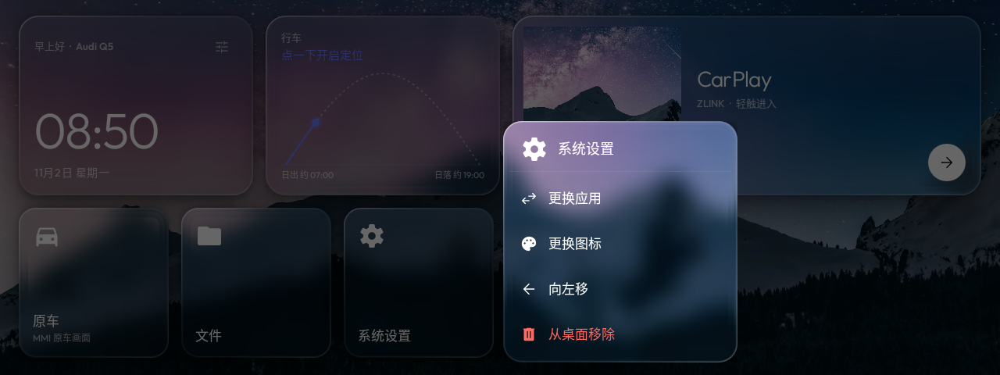
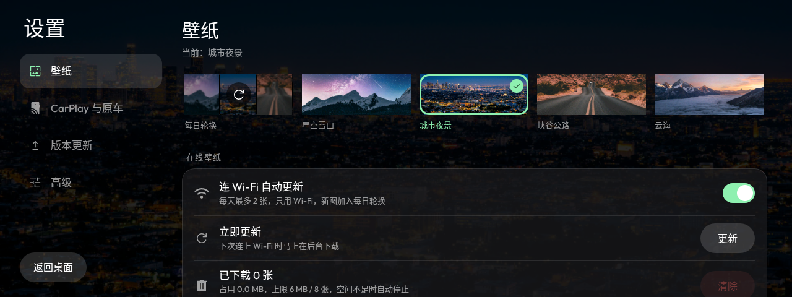

# q5home

[](https://github.com/244gk/qqqqqhome/actions/workflows/launcher.yml?query=branch%3Amain)
[](https://github.com/244gk/qqqqqhome/releases/latest)
[](https://github.com/244gk/qqqqqhome/releases/latest/download/q5home.apk)


A clean launcher and debloat tools for the Android widescreen head unit (WY firmware, Android 12) in a 2014 Audi Q5 (8R).

Goals:
- A clean, CarPlay-first launcher that keeps an entry point to the original car system ("原车").
- Use ADB to disable (not uninstall) unneeded preinstalled apps, with one-step restore. Approach inspired by [CleanYourTV](https://github.com/Gathin23/cleanyourtv).

## Progress

1. Read-only recon: `tools/recon.sh` (needs adb, see below); without adb, use Desktop settings ("桌面设置") → Head unit recon ("车机摸底") in the launcher
2. Launcher app: `launcher/` (Kotlin, see "Launcher app" below)
3. Debloat: to be done after recon is complete

## Step 1: Read-only recon

### 1. Install adb on the Mac

```bash
brew install android-platform-tools
```

### 2. Connect to the head unit (either way)

**Wireless debugging (recommended)**: put the head unit and the Mac on the same Wi-Fi (e.g. both on an iPhone hotspot;
disconnect wireless CarPlay during recon so it doesn't compete for Wi-Fi). On the head unit: Developer options → Wireless debugging → Pair device with pairing code.

```bash
adb pair <head-unit-IP>:<pairing-port>     # enter the pairing code shown on the head unit
adb connect <head-unit-IP>:<debug-port>    # the port shown on the Wireless debugging page
```

**USB**: connect the Mac to the head unit's USB port with a data cable and tap "Allow USB debugging" on the head unit.
(On some head units the USB port only accepts flash drives and cannot be used for debugging; use wireless in that case.)

Once connected, `adb devices` should list the device.

### 3. Run recon

Open a coding assistant in this repository and paste in the contents of [PROMPT.md](PROMPT.md).
You can also run it by hand:

```bash
tools/recon.sh                    # when already connected
tools/recon.sh 192.168.x.x:port   # connect first
```

The script is read-only and changes nothing on the head unit. Output goes to `recon/`, contains the device serial number, and is git-ignored.

Safety rules are in [AGENTS.md](AGENTS.md).

## Step 2: Launcher app (launcher/)

Styled after the [CleanYourTV](https://github.com/Gathin23/cleanyourtv) launcher: black background, big clock, frosted pill buttons,
and the selected tile's name with ambient light. Kotlin + classic Views, no third-party dependencies, APK about 1 MB (mostly wallpapers).



| Long-press a tile | Settings |
|---|---|
|  |  |
(1280×480 previews generated by screenshot tests.)

- **Big CarPlay tile**: finds ZLINK / DiPlay automatically; if not found, long-press to choose.
- **Original car tile**: finds the original car ("原车") app by name automatically; once recon finds the real switching component, set it in config.json.
- **Favorite apps**: defaults are Files ("文件") and System settings ("系统设置", Android's own settings). Tap "+" to add; long-press to change the app, change the icon, move or remove.
  Swiping left/right anywhere on empty space on the home screen (clock, name, wallpaper) scrolls the tiles at the bottom; no need to aim at the tile row.
- **Unified icons**: home screen icons are a redrawn set (CarPlay, original car, Files, System settings, Navigation, Phone, etc.).
  Each tile stores "icon + target app", so switching apps later only changes the target (app id); the icon stays.
- **Wallpapers**: 6 built-in Unsplash wallpapers, rotating automatically by default; you can pick one or use pure black (sources in [CREDITS.md](CREDITS.md)).
  Rotation interval: 30 minutes / hourly / 3 hours / daily (Desktop settings ("桌面设置") → Wallpaper ("壁纸") → Rotation interval ("轮换频率"), or `wallpaperInterval` in config.json, in minutes).
- **Online wallpaper updates**: on Wi-Fi, downloads up to 2 new wallpapers a day and adds them to the rotation (see "Online wallpapers" below).
- **Default launcher**: Desktop settings ("桌面设置") → Advanced ("高级") → Default launcher ("默认桌面"): Set as default ("设为默认") shows the system confirmation dialog (no adb needed); Restore stock launcher ("恢复原厂桌面") opens the system Home app settings so you can pick the stock launcher again.
  After switching, run through the in-car checks (reversing camera, original car screen, sidebar, CarPlay, ignition off and restart).
- **Head unit recon (no adb)**: Desktop settings ("桌面设置") → Head unit recon ("车机摸底"). Read-only look at the system, debug / root clues (build type, su files, adb port),
  vendor apps' entry points / exported Activities / broadcasts, and a list of likely original car, CarPlay and debug pages that you can try with Open ("打开") or Set as original car ("设为原车").
  The report can be submitted as a GitHub Issue on this repository: tap Generate QR code ("生成二维码"), scan it with your phone to open a temporary web page on the head unit (same network, closes after 15 minutes),
  paste a fine-grained token (this repository only, Issues read/write permission only), and the head unit submits it itself; the token is stored only in Q5 Home on the head unit.
- **Appearance**: minimal Bento cards (layered shadows, 1px border, inner glow at the top). Default is Auto ("自动"): light during the day, dark after sunset (based on sunrise/sunset).
  You can also fix it to light / dark under Desktop settings ("桌面设置") → Appearance & wallpaper ("外观与壁纸") (`appearance` in config.json: auto / light / dark).
- **Home GPS**: below the clock, shows speed, heading (while driving) and altitude; only shown with a fresh fix (can be turned off on the GPS & 4G ("GPS 与 4G") page).
- **Sunrise/sunset wallpapers**: Desktop settings ("桌面设置") → Wallpaper ("壁纸") → when on, only daytime wallpapers rotate during the day and night scenes after sunset. Sunrise/sunset is computed in the car from a rough GPS position
  (only 1 decimal place stored), offline; without a previous fix it uses 7:00–19:00.
- **GPS & 4G**: Desktop settings ("桌面设置") → GPS & 4G ("GPS 与 4G"). Read-only view of satellite count / signal strength / fix status, SIM card, carrier, network type,
  signal bars and dBm, and whether traffic currently goes over Wi-Fi or 4G. 4G connectivity test ("4G 上网测试") makes one request to a test URL over mobile data only.
  The first time, the system asks for permissions (location, phone state). The recon report includes this section too (without coordinates).
- **Update check**: checks GitHub Releases once a day; when a new version is available, a green New version ("新版本") pill appears in the top-right of the home screen.
  Desktop settings ("桌面设置") → Version update ("版本更新") shows the release notes and downloads and installs it (see "Versions and updates" below).
- Apps ("应用") in the top-right is the full app list; Desktop settings ("桌面设置") is Q5 Home's own full-page settings (distinct from the System settings ("系统设置") tile = Android settings): categories on the left (Wallpaper / CarPlay & original car / Advanced), content on the right.
  Wallpapers are picked by thumbnail, switches are toggle switches, and online wallpaper storage use is shown directly.
- All menus, confirmation dialogs and notices are drawn by the launcher itself (frosted dark cards) instead of the system's grey dialogs;
  only System settings ("系统设置") and App info ("应用信息") jump to Android's own pages.
- Supports touch as well as rotary knob / D-pad focus (white outline).

### Install

Requires JDK 17 and the Android SDK (installing Android Studio is easiest), then:

```bash
launcher/build-and-install.sh            # build, install and open for a trial; does not change the default launcher
launcher/build-and-install.sh --set-home # once the trial looks good, set as default launcher (asks for confirmation and prints rollback commands)
```

Don't want the SDK on your Mac? Use the APK built by GitHub Actions (see "CI" below),
then `launcher/build-and-install.sh --apk downloaded.apk`.

### CI (GitHub Actions)

Runs on every push touching `launcher/` or `ci/`; download the artifacts from the run on the repository's Actions page:

| Artifact | Contents |
|---|---|
| `q5home-apk` | Launcher APK, ready to install on the head unit |
| `screenshots` | Screenshot tests: 1280×480, 1920×720, 1024×600, pure black wallpaper, app list |
| `test-reports` | Unit test and lint reports |
| `emulator-demo` | Screen recording and per-step screenshots on an Android 12 emulator (1920×720) (see below) |

In `emulator-demo`:
- `demo.mp4`: demo recording. Below the video is a caption bar with Chinese step captions; taps show a white ring, long-presses an orange ring; key presses (HOME, Back, D-pad) are shown in the captions.
- `demo-raw.mp4` + `captions.srt` + `taps.json`: raw recording, captions and tap log.
- `NN-*.png`: per-step screenshots, with a red circle marking where that step tapped.

The emulator uses a fake ZLINK and a fake original car app built from `launcher/fakeapps` (CI only; never install them on the head unit).
Demo steps are in `ci/demo.py`. Run tests locally: `cd launcher && ./gradlew :app:testDebugUnitTest`.

### Configure with config.json

```bash
adb push config.json /sdcard/Android/data/com.x0finch.q5home/files/config.json
adb pull /sdcard/Android/data/com.x0finch.q5home/files/current.json   # view the configuration currently in effect
```

Fields are documented in [launcher/config.example.json](launcher/config.example.json).

- Target formats: `package`, `package/class`, `action:ACTION`, `broadcast:ACTION@package`.
- Each `dock` entry can be `{"icon": "files", "target": "package"}`, or just a target (icon is guessed).
  Available icons: `carplay` `oem` `files` `settings` `nav` `phone` `radio` `video` `music` `bluetooth` `browser` `photos` `apps`.
- `wallpaper`: `daily` (daily rotation), `none` (pure black), or `stars` `city` `road` `clouds` `lake` `forest`.

### Online wallpapers

On **Wi-Fi (unmetered networks)**, a background job downloads up to 2 new wallpapers a day and adds them to the automatic rotation.

- **Source**: by default reads the manifest in this repository, [wallpapers/feed.json](wallpapers/feed.json); the head unit downloads new entries the next time it is on Wi-Fi, no APK reinstall needed.
  **Automatic manifest updates**: the `wallpapers` workflow ([.github/workflows/wallpapers.yml](.github/workflows/wallpapers.yml)) picks 3 new landscape photos from Unsplash once a week (Sundays)
  (rotating themes such as night scenes, mountains, cities, roads), appends them to the manifest with photographer credits, and keeps at most 60 entries.
  One-time setup: create an app at [unsplash.com/developers](https://unsplash.com/developers) to get an Access Key,
  and add `UNSPLASH_ACCESS_KEY` under the repository's Settings → Secrets and variables → Actions; if not set, the job is skipped.
  You can also run `wallpapers` by hand from the Actions page and choose how many to add. Appending Unsplash photo ids to the end of the manifest by hand also works.
  Want a brand-new image every day? Get a free Access Key at [unsplash.com/developers](https://unsplash.com/developers),
  put it in `unsplashKey` in config.json, and images are picked at random by `wallpaperQuery`, with the photographer credit shown in the bottom-right.
- **Storage limits**: at most 8 images and 6 MB in total; the oldest are deleted beyond that. Each image is cropped to the screen by Unsplash's servers before download (about 300–400 KB);
  any single image over 1.5 MB is skipped. When free space on the head unit is below 300 MB, nothing is downloaded and only the newest 2 are kept.
- **In settings**: online wallpapers on/off, update now, clear online wallpapers (shows current usage). Built-in wallpapers are unaffected.

## Versions and updates

- **Version number**: `1.0.<commit count>`, incremented automatically with each commit (internal versionCode = commit count × 10; the last digit is used for rollback releases).
- **Download**: the "Download latest" badge at the top of this README downloads the latest APK directly (`releases/latest/download/q5home.apk`);
  the "Latest release" badge opens the latest Release page (versioned APK and release notes).
- **Release**: on every push to `main`, once CI build, tests and the emulator demo pass, a GitHub Release `v1.0.<commit count>` is published automatically with the APK attached;
  release notes come from the commit message.
- **Updating on the head unit**: Desktop settings ("桌面设置") → Version update ("版本更新") → Download and install ("下载并安装"). After download, the sha256, package name and version are verified, then Android's install confirmation appears.
  The first time, Q5 Home must be allowed to Install unknown apps ("安装未知应用") (the page guides you to system settings); if the head unit doesn't show that switch, run from a computer:
  ```bash
  adb shell appops set com.x0finch.q5home REQUEST_INSTALL_PACKAGES allow
  ```
- **Signing**: release builds are signed with the owner's private key; **the key is not in the repository**:
  - CI: `Q5HOME_KEYSTORE` (base64 of the keystore file) and `Q5HOME_KEYSTORE_PASSWORD` under the GitHub repository's Settings → Secrets and variables → Actions.
    After the build, the APK signature is checked against the key; on main, a missing key fails the build, so a wrongly signed version is never released.
  - Local (Mac): in `~/.gradle/gradle.properties` set
    `Q5HOME_KEYSTORE=/Users/you/q5home-release.keystore` and `Q5HOME_KEYSTORE_PASSWORD=password` (the key alias must be `q5home`).
  - Without a configured key, local builds use a temporary debug signature: fine for your own testing, but they cannot be installed over a release build already on the head unit.
  - **Back up the keystore file and password**: if they are lost, new versions cannot be installed over the old one; you can only uninstall and reinstall (settings are lost).
  - Versions 1.0.13 and earlier were signed with a public key that used to live in the repository and differs from the current signature: head units that have them installed must uninstall before installing a new version,
    and the rollback workflow cannot roll back to those versions.

## What if an update breaks something (crash rollback)

Three layers of protection:

1. **Prevent**: a release is only published if the emulator demo passes (including "no unexpected crashes"), so crashing builds never reach the head unit.
2. **Protect**: if the same version crashes 3 times within 10 minutes, the launcher enters **safe mode** automatically: a minimal page (no wallpaper, tiles or online features)
   with big buttons for Open CarPlay ("打开 CarPlay"), Open original car ("打开原车"), Back to stock launcher ("回到原厂桌面"), Install fix / rollback version ("安装修复 / 回退版本") and Try normal start again ("再试一次正常启动"), so it never gets stuck in a crash loop.
   Installing a new version (fix or rollback) restores normal mode automatically.
3. **Roll back**: Android doesn't allow installing a package with a lower version number directly, so use one of these:
   - **Rollback release (recommended, no computer needed)**: on your phone open the GitHub repository → Actions → **rollback** → Run workflow,
     and enter the version to roll back to (e.g. `1.0.12`). A few minutes later `1.0.<current commit count>.1` is published with that old version's contents;
     install it on the head unit from safe mode or Version update ("版本更新").
   - **Fix release**: revert the bad change (`git revert`) and push to main; a new version is released automatically.
   - **adb downgrade** (needs a computer, and the head unit must allow downgrades, i.e. `getprop ro.debuggable` is 1): `adb install -r -d old-version.apk`.

Android also has its own safety net: if the default launcher crashes repeatedly, the system drops its default status and asks you to pick a launcher when you press HOME;
you can pick the stock launcher right there.

Settings data always stays backward compatible, so after a rollback the old version can still read settings saved by the newer version.
